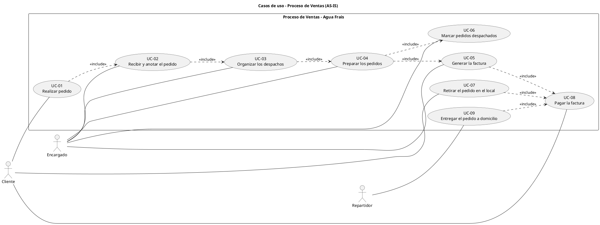

# Casos de uso de la vida real — Proceso de Ventas (AS-IS)

**Proyecto:** Sistema de Gestión para Tienda de Agua Embotellada "Agua Frais"
**Curso:** Ingeniería de Software — Universidad de Cartagena
**Iteración:** 3 — Modelo de negocio
**Artefacto:** Casos de uso de la vida real (Actividades de negocio)
**Responsable:** Analista del sistema

## 1. Identificación de los casos de uso

A partir de las actividades (óvalos) del diagrama de actividades con carriles (swimlanes) `ProcesoDeNegocio_Ventas.puml`, se derivaron los casos de uso de la vida real. Se tomaron únicamente las actividades de negocio, sin proyectar funciones del sistema (TO-BE).

| Código | Caso de uso | Actividad de negocio (origen) | Actor primario | Actor(es) secundario(s) |
|---|---|---|---|---|
| **UC-01** | Realizar pedido | Solicitar pedido por llamada / WhatsApp / Realizar pedido de forma presencial | Cliente | Encargado |
| **UC-02** | Recibir y anotar el pedido | Recibir pedido por llamada telefónica / WhatsApp / presencial + Anotar pedido en libreta | Encargado | Cliente |
| **UC-03** | Organizar los despachos | Organizar pedidos pendientes en memos por zona/ruta, cantidades y capacidad de los vehículos (decisión manual) | Encargado | — |
| **UC-04** | Preparar los pedidos | Preparar pedidos para despacho | Encargado | — |
| **UC-05** | Generar la factura | Generar Fact (-> Fact, -> C.C.) | Encargado | — |
| **UC-06** | Marcar pedidos despachados | Marcar pedidos despachados en la libreta (colocar marca de verificación) | Encargado | — |
| **UC-07** | Retirar el pedido en el local | Retirar pedido en el local | Cliente | Encargado |
| **UC-08** | Pagar la factura | Pagar Fact (-> Recibo) / Recibir pedido y pagar Fact (-> Recibo) | Cliente | Encargado / Repartidor |
| **UC-09** | Entregar el pedido a domicilio | Entregar pedidos agrupados por ruta/despacho | Repartidor | Cliente |

## 2. Descripción de los casos de uso (actividades de negocio)

### UC-01 — Realizar pedido
**Descripción:** El cliente solicita un pedido al negocio, utilizando uno de los canales de atención con los que opera actualmente: llamada telefónica, WhatsApp o de forma presencial. Esta es la actividad de negocio mediante la cual se inicia el proceso de ventas.

**Actor primario:** Cliente

**Actor secundario:** Encargado

**Precondición:** El negocio se encuentra en operación (atendiendo pedidos).

**Flujo principal:**
1. El cliente decide realizar un pedido.
2. El cliente selecciona el canal (llamada, WhatsApp o presencial) para realizar su solicitud.
3. El cliente comunica los productos, cantidades y datos necesarios para su pedido.

**Postcondición:** La solicitud del pedido queda hecha y pasa a ser recibida y registrada por el Encargado.

**Extensiones:** Según el canal elegido (llamada, WhatsApp o presencial), varía la forma de comunicación, pero corresponde a la misma actividad de negocio.

### UC-02 — Recibir y anotar el pedido
**Descripción:** El encargado recibe la solicitud de pedido realizada por el cliente (por llamada, WhatsApp o presencial) y la anota en la libreta. Esta actividad consolida la recepción y el registro manual del pedido.

**Actor primario:** Encargado

**Actor secundario:** Cliente

**Precondición:** Existe una solicitud de pedido (UC-01).

**Flujo principal:**
1. El encargado recibe la solicitud del cliente por el canal correspondiente.
2. Verifica y toma los datos del pedido (cliente, productos, cantidades, forma de entrega).
3. Anota el pedido en la libreta.

**Postcondición:** El pedido queda registrado en la libreta, identificado como pendiente de despacho.

### UC-03 — Organizar los despachos
**Descripción:** El encargado revisa los pedidos pendientes registrados en la libreta y los organiza en los memos, teniendo en cuenta la zona o ruta de entrega, las cantidades solicitadas y la capacidad disponible de los vehículos de reparto. Esta es una **decisión manual** del encargado (tal como se establece en el alcance del proyecto).

**Actor primario:** Encargado

**Precondición:** Existen pedidos pendientes registrados en la libreta (UC-02).

**Flujo principal:**
1. El encargado identifica los pedidos pendientes.
2. Agrupa los pedidos por zona/ruta, considerando las cantidades y la capacidad del vehículo.
3. Distribuye o asigna los pedidos a los despachos correspondientes en los memos.

**Postcondición:** Los pedidos pendientes quedan organizados para su despacho.

### UC-04 — Preparar los pedidos
**Descripción:** El encargado prepara físicamente los productos correspondientes a los pedidos organizados para el despacho, dejándolos listos para su facturación, marcación de despacho y entrega.

**Actor primario:** Encargado

**Precondición:** Los pedidos han sido organizados (UC-03).

**Flujo principal:**
1. El encargado toma los pedidos asignados al despacho.
2. Reúne y prepara los productos solicitados por cada pedido.
3. Deja los pedidos preparados para continuar con el proceso de ventas.

**Postcondición:** Los pedidos se encuentran preparados para despacho.

### UC-05 — Generar la factura
**Descripción:** El encargado genera la factura correspondiente al pedido (o a los pedidos del despacho, según la organización realizada). Según lo indicado en el modelo base del profesor, se generan los documentos `Fact` y `C.C.`.

**Actor primario:** Encargado

**Precondición:** El pedido se encuentra preparado (UC-04).

**Flujo principal:**
1. El encargado elabora/genera la factura del pedido.
2. Se registran/obtienen los documentos asociados (Fact y C.C.), conforme al proceso de negocio actual.

**Postcondición:** Existe la factura (y sus documentos asociados) para proceder al cobro y al despacho.

### UC-06 — Marcar pedidos despachados
**Descripción:** A medida que los pedidos salen para su entrega, el encargado coloca una marca de verificación en la libreta para identificar cuáles han sido despachados y cuáles permanecen pendientes. Esta actividad representa el cambio de estado **Pendiente → Despachado** dentro del proceso de negocio actual.

**Actor primario:** Encargado

**Precondición:** El pedido está preparado (UC-04).

**Flujo principal:**
1. El encargado identifica el pedido que va a ser despachado.
2. Coloca la marca de verificación en la libreta, marcando dicho pedido como despachado.

**Postcondición:** El estado del pedido queda registrado como despachado en la libreta.

### UC-07 — Retirar el pedido en el local
**Descripción:** En el caso de entrega en sitio (retiro en el local), el cliente se presenta para retirar el pedido que ya fue preparado y facturado.

**Actor primario:** Cliente

**Actor secundario:** Encargado

**Precondición:** El pedido está preparado (UC-04).

**Flujo principal:**
1. El cliente acude al local para retirar su pedido.
2. Se identifica el pedido correspondiente (con base en lo preparado y facturado).
3. El cliente retira el pedido.

**Postcondición:** El pedido ha sido entregado al cliente en el local, quedando listo para el cobro (UC-08).

### UC-08 — Pagar la factura
**Descripción:** El cliente realiza el pago de la factura correspondiente al pedido. Según el modelo base, al realizar el pago se genera el **Recibo**. Esta actividad ocurre tanto en el caso de retiro en sitio como en el caso de entrega a domicilio.

**Actor primario:** Cliente

**Actores secundarios:** Encargado (retiro en sitio) / Repartidor (entrega a domicilio)

**Precondición:** Existe factura generada (UC-05) y el pedido está listo para entrega/retiro.

**Flujo principal:**
1. Se presenta la factura al cliente (en sitio o a domicilio).
2. El cliente realiza el pago de la misma.
3. Se genera el recibo como comprobante del pago.

**Postcondición:** La venta queda registrada como pagada (ciclo de ventas completado para ese pedido).

### UC-09 — Entregar el pedido a domicilio
**Descripción:** En el caso de entrega a domicilio, el repartidor entrega los pedidos agrupados por ruta/despacho al cliente. Corresponde a la entrega física de los productos organizados en lote (agrupados por ruta).

**Actor primario:** Repartidor

**Actor secundario:** Cliente

**Precondición:** Los pedidos han sido preparados, facturados y marcados como despachados (UC-04, UC-05, UC-06).

**Flujo principal:**
1. El repartidor toma el lote de pedidos asignados a su ruta/despacho.
2. Realiza la entrega del pedido correspondiente al cliente.
3. Entrega la factura para su pago (UC-08).

**Postcondición:** El pedido ha sido entregado físicamente al cliente en su domicilio.

## 3. Diagrama de casos de uso (PlantUML)

## 4. Observaciones

- **Derivación directa de las actividades:** Cada caso de uso corresponde a un óvalo (actividad) del diagrama de actividades con carriles. No se tomó como base los requisitos funcionales (RF), sino las actividades de negocio (casos de uso de la vida real).
- **Proceso AS-IS:** Se modela el funcionamiento actual del negocio (tal como concluyó el acta de entrevista del 26/08/2026), respetando el core del modelo base entregado por el profesor (factura, C.C. y recibo).
- **Estructura por flujo:** Las relaciones `<<include>>` representan la secuencia lógica del proceso de negocio, derivada del orden de ejecución de las actividades en el swimlane.