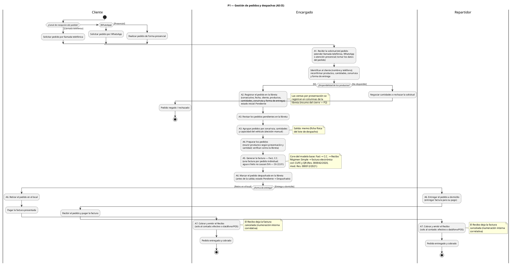
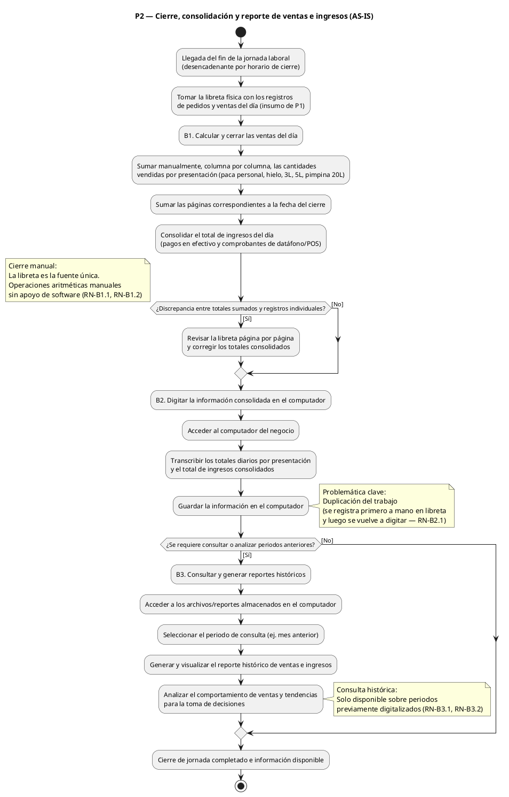

# Procesos de negocio (AS-IS) — Agua Frais

**Proyecto:** Sistema de Gestión para Tienda de Agua Embotellada "Agua Frais"
**Curso:** Ingeniería de Software — Universidad de Cartagena
**Iteración:** 3 — Modelo de negocio
**Artefacto:** Procesos de negocio
**Responsable:** Analista del sistema
**Evidencia:** Acta de entrevista al propietario, 26/08/2026 (Anexo C)

> Jerarquía de abstracción (Notas de clase): **proceso > actividad > acción**.
> El proceso tiene el mayor nivel de abstracción: secuencia de actividades con
> desencadenante, objetivo, responsable y resultado.

---

## P1 — Gestión de pedidos y despachos (proceso principal)

- **Desencadenante:** El cliente solicita un pedido (llamada telefónica, WhatsApp o presencial).
- **Objetivo:** Completar el ciclo de vida del pedido: recibirlo, organizarlo, entregarlo y cobrarlo.
- **Responsable:** Encargado (participan también Cliente y Repartidor).
- **Resultado:** Pedido entregado y cobrado; estado del pedido controlado (Pendiente → Despachado).

### Composición

P1 contiene **dos etapas internas** (no son procesos separados; son las dos
grandes fases del mismo flujo):

- **Etapa 1 — Gestión del pedido y facturación:** A1 a A5 (intake, registro,
  organización, preparación y facturación; la realiza el Encargado).
- **Etapa 2 — Despacho, entrega y cobro:** A6 y A7 (entrega en local o a
  domicilio con Repartidor, y cobro).

```
P1 — Gestión de pedidos y despachos (proceso)
│
│  [Etapa 1 — Gestión del pedido y facturación — Encargado]
├─ A1. Recibir la solicitud del pedido (actividad)
│    ├─ Atender llamada telefónica (acción)
│    ├─ Atender mensaje de WhatsApp (acción)
│    └─ Atender cliente presencial (acción)
├─ A2. Registrar el pedido en la libreta (actividad)
│    └─ Anotar cliente, productos, cantidades, ruta (acciones atómicas)
│    ※ También se  registran aquí las ventas por presentación en la libreta (columnas)
├─ A3. Organizar los pedidos para despacho en memos (actividad)
│    ├─ Revisar pedidos pendientes (acción)
│    └─ Agrupar por zona/ruta, cantidades y capacidad del vehículo (acción)
├─ A4. Preparar los pedidos (actividad)
├─ A5. Generar la factura — Fact, C.C. (actividad)
│
│  [Etapa 2 — Despacho, entrega y cobro — Encargado / Repartidor]
├─ A6. Despachar y entregar (actividad)
│    ├─ Retiro en el local / Entrega a domicilio por repartidor (acciones)
│    └─ Marcar despachado en la libreta (cambio Pendiente → Despachado)
└─ A7. Cobrar y emitir el Recibo (actividad)
```

> **Nota sobre la posible separación en dos procesos.** Las dos etapas reflejan
> un cambio real de actor (Encargado → Repartidor) y de granularidad (el
> **pedido** es por cliente; el **despacho** es por lote/ruta). Si se pidiera
> mayor granularidad, la Etapa 1 podría extraerse como proceso "Gestión de
> pedidos y facturación" y la Etapa 2 como proceso "Despacho, entrega y
> cobro". Por ahora se mantiene como un solo proceso para conservar el core
> del modelo base (Fact → C.C. → Recibo en un flujo) y reducir artefactos.

### Reglas de negocio reflejadas en P1

- Los pedidos se organizan manualmente por zona/ruta, cantidades y capacidad de los vehículos (decisión del encargado; no se automatiza).
- El seguimiento del estado depende de la marca de verificación en la libreta (Pendiente / Despachado).
- El core del proceso de ventas conserva los documentos del modelo base: **Fact**, **C.C.** y **Recibo**.

### Diagrama de carriles (swimlane) — P1

Archivo: `ProcesoDeNegocio.puml` (PlantUML). Contenido embebido como respaldo:



---

# Detalle textual del Proceso P1 — Gestión de pedidos y despachos (AS-IS)

Especificación textual rigurosa de las actividades A1–A7, sin diagramas.
Convención de fuentes: **[E]** entrevista 26/08/2026, **[M]** modelo base del
profesor (Fact → C.C. → Recibo), **[N]** normativa colombiana vigente.
Datos validados con el negocio: (1) la factura se emite **por pedido
individual**; (2) el negocio opera en el **Régimen Simple de Tributación**;
(3) las ventas son **solo al contado**; (4) un pedido no entregado **vuelve a
Pendiente**; (5) **no** se aceptan transferencias bancarias (efectivo y
datáfono/POS).

## A1. Recibir la solicitud del pedido

| Campo | Contenido |
|---|---|
| **Responsable** | Encargado |
| **Participantes** | Cliente |
| **Desencadenante** | El cliente contacta al negocio (llamada, WhatsApp o presencial) |
| **Precondición** | El negocio está en operación, atendiendo pedidos |

**Procedimiento:**
1. El cliente inicia contacto por uno de los canales: llamada telefónica, mensaje WhatsApp o acudir al local [E].
2. El encargado atiende la solicitud e identifica al cliente (nombre y teléfono) [E — pregunta 4].
3. El encargado obtiene o reconfirma los datos del pedido:
   a. Presentación: paca personal, paca para hielo, paca de 3 L, paca de 5 L o pimpina de 20 L [E — contexto 1.1].
   b. Cantidad por presentación.
   c. Zona o ruta de entrega.
   d. Forma de entrega: retiro en local o a domicilio [E].
   e. Medio de recepción: llamada, WhatsApp o presencial [E].
4. El encargado verifica la disponibilidad de los productos solicitados mediante revisión manual del stock existente [E — sin sistema formal de inventario].
5. Si hay disponibilidad, confirma el pedido al cliente; si no la hay, negocia cantidades o rechaza la solicitud.

**Reglas de negocio:**
- **RN-1.1** El negocio opera con tres canales de recepción de pedidos: llamada telefónica, WhatsApp y atención presencial [E].
- **RN-1.2** Si el pedido proviene de un cliente habitual, el encargado debe reconfirmar productos y cantidades, aunque en la práctica sean similares a pedidos anteriores [E — pregunta 4].

**Excepciones:**
- Solicitud incompleta (falta cantidad, zona o forma de entrega): el encargado solicita los datos faltantes antes de continuar.
- Sin disponibilidad del producto: se ofrece sustitución parcial/negociación o se rechaza el pedido (queda registrado como negado, RN-6.4 de A6).

**Salida:** Solicitud de pedido completa y aceptada, lista para su registro en la libreta (A2).

---

## A2. Registrar el pedido en la libreta

| Campo | Contenido |
|---|---|
| **Responsable** | Encargado |
| **Desencadenante** | Confirmación del pedido en A1 |
| **Precondición** | A1 completada con datos confirmados |

**Procedimiento:**
1. El encargado anota el pedido en la libreta con: consecutivo, fecha, cliente, teléfono, productos y cantidades por presentación, zona/ruta y forma de entrega [E].
2. El pedido queda con estado inicial **Pendiente** [E].
3. En las columnas de la libreta correspondientes a cada presentación se suma el volumen vendido; estas columnas son la fuente del cierre del día (subproceso P2) [E — pregunta 3].

**Reglas de negocio:**
- **RN-2.1** Todo pedido debe quedar registrado en la libreta antes de ser organizado para despacho [E].
- **RN-2.2** El estado inicial de todo pedido es **Pendiente** [E].
- **RN-2.3** La libreta es el soporte interno primario del registro; su uso genera la duplicación de trabajo identificada como problemática (la información se registra aquí y luego se digita en el computador en P2) [E].

**Normativa:**
- La libreta opera como **soporte interno** de los hechos económicos, que debe conservarse archivado en orden cronológico (Anexo 6, art. 6, Decreto 2420 de 2015) [N].

**Salida:** Pedido registrado en la libreta con estado **Pendiente**.

---

## A3. Organizar los pedidos para despacho en memos

| Campo | Contenido |
|---|---|
| **Responsable** | Encargado |
| **Desencadenante** | Acumulación de pedidos pendientes y decisión del encargado de armar un despacho |
| **Precondición** | Existen pedidos en estado Pendiente en la libreta (A2) |

**Procedimiento:**
1. El encargado revisa la libreta e identifica todos los pedidos en estado Pendiente [E].
2. Filtra los pedidos por **zona o ruta de entrega** [E].
3. Agrupa los pedidos que pueden viajar juntos, considerando las **cantidades solicitadas** y la **capacidad disponible del vehículo** de reparto [E].
4. El encargado registra cada lote de despacho en una ficha denominada **"memo"**: pedidos incluidos, rutas, direcciones y cantidades [E — pregunta 2].
5. Los pedidos que no caben en el lote permanecen Pendientes para el siguiente despacho.

**Reglas de negocio:**
- **RN-3.1** La agrupación de pedidos en despachos es una **decisión manual** del encargado; el negocio no usa algoritmos ni rutas automatizadas [E].
- **RN-3.2** La capacidad del vehículo por viaje es límite duro de cada despacho [E].
- **RN-3.3** Los pedidos se agrupan prioritariamente por zona/ruta [E].
- **RN-3.4** El memo es la ficha física que organiza los pedidos de un despacho y permite saber cuáles están listos, en camino y faltantes [E — pregunta 2].

**Salida:** Memos (lotes de despacho) definidos; pedidos asignados a un despacho concreto.

---

## A4. Preparar los pedidos

| Campo | Contenido |
|---|---|
| **Responsable** | Encargado |
| **Desencadenante** | Memo(s) definido(s) en A3 |
| **Precondición** | Pedidos organizados y asignados a un despacho |

**Procedimiento:**
1. Por cada memo, el encargado toma la lista de pedidos asignados.
2. Reúne físicamente los productos de cada pedido (según presentación y cantidad).
3. Verifica que las cantidades preparadas correspondan a las registradas en la libreta/memo.
4. Deja el lote preparado para facturación (A5) y despacho (A6).

**Reglas de negocio:**
- **RN-4.1** La preparación es física y manual; se hace producto por producto contra el registro de la libreta [E].

**Excepciones:**
- Faltante de producto en el momento de preparar: el encargado ajusta el pedido con el cliente o deja el pedido para el siguiente despacho.

**Salida:** Pedidos preparados físicamente, listos para facturación y despacho.

---

## A5. Generar la Factura (Fact) y el Comprobante de Contabilidad (C.C.)

| Campo | Contenido |
|---|---|
| **Responsable** | Encargado |
| **Desencadenante** | Pedido preparado en A4 |
| **Precondición** | Pedido preparado y con cliente, productos y cantidades confirmados |

**Procedimiento:**
1. El encargado verifica que la venta es **al contado**; el negocio no opera ventas a crédito (validado con el negocio).
2. Calcula el total del pedido: por cada presentación, cantidad × precio unitario; suma los subtotales y obtiene el total [E — pregunta 1].
3. Determina el tratamiento del IVA: el agua (mineral, natural o artificial, gasificada), **sin adición de azúcar u otro edulcorante ni aromatizada, y el hielo, no causan IVA** (CA 22.01, art. 424 numeral 4 del Estatuto Tributario) [N]. Si el negocio vende productos sí afectos, se aplica la tarifa vigente a esos productos.
4. Genera la **Factura electrónica de venta (Fact)** por **pedido individual** (validado con el negocio) [M + N]:
   a. El negocio opera en el **Régimen Simple de Tributación** (Ley 2069 de 2021); por el art. 915 del E.T. está obligado a expedir **factura electrónica**, que debe adoptar dentro de los dos (2) meses siguientes a su inscripción en el RUT (art. 1.6.1.4.28 del Decreto 1625 de 2016) [N].
   b. La factura electrónica se genera conforme al Anexo Técnico de la Resolución 000042 de 2020, modificada por la Resolución 000012 de 2021 (régimen consolidado vigente: Resolución 165 de 2023), con **CUFE** (Código Único de Factura Electrónica) y código **QR** [N].
   c. La numeración se rige por el **prefijo y la numeración consecutiva y correlativa** autorizados por la DIAN; no se permiten saltos ni duplicidades [N].
   d. La factura contiene los requisitos del art. 616-1 del E.T. (fecha, vendedor, comprador, productos, cantidades, precio, total) [N].
5. Genera el **Comprobante de Contabilidad (C.C.)** por pedido, como documento interno que respalda contablemente la operación [M], con:
   a. Numeración **consecutiva** [N — Anexo 6, art. 7, Decreto 2420 de 2015].
   b. Fecha de preparación y personas que lo elaboraron y autorizaron [N].
   c. Origen, descripción, cuantía de la operación y cuentas afectadas [N].
6. El encargado conserva la factura electrónica (XML/QR) y el C.C. como soportes; entrega/copía al cliente según lo acordado [N].

**Reglas de negocio:**
- **RN-5.1** No se entrega ningún pedido sin factura generada [M — core: Fact antes de Recibo].
- **RN-5.2** Se emite **una factura por pedido individual**, no por lote/despacho (validado con el negocio).
- **RN-5.3** La numeración de facturas no puede tener saltos ni duplicidades; debe seguir la correlatividad autorizada [N].
- **RN-5.4** Toda factura debe estar respaldada por su comprobante de contabilidad interno [M + N].

**Normativa aplicable:**
- Art. 616-1 E.T. — requisitos de la factura de venta.
- Art. 424 num. 4 E.T. — agua e hielo no causan IVA.
- Art. 915 E.T. y art. 1.6.1.4.28 del Decreto 1625 de 2016 — obligación y adopción de factura electrónica para contribuyentes del Régimen Simple.
- Res. 000042/2020, Res. 000012/2021, Res. 165/2023 (DIAN) — numeración, prefijo, factura electrónica, CUFE y QR.
- Anexo 6, art. 7, Decreto 2420 de 2015 — comprobantes de contabilidad: numeración consecutiva y contenido.

**Excepciones:**
- Falla del sistema de facturación electrónica de la DIAN: se aplica el procedimiento de inconvenientes tecnológicos previsto en el Anexo Técnico (Res. 000012/2021) [N].
- Cliente no identificado fiscalmente: se factura con la identificación disponible (consumidor final) *(supuesto — verificar práctica del negocio)*.

**Salida:** Factura electrónica (Fact) y Comprobante de Contabilidad (C.C.) emitidos por el pedido.

---

## A6. Despachar y entregar

| Campo | Contenido |
|---|---|
| **Responsable** | Encargado (salida) / Repartidor (entrega) |
| **Desencadenante** | Pedido preparado y facturado, organizado en memo |
| **Precondición** | Fact y C.C. emitidos (A5); memo con lote definido (A3) |

**Procedimiento:**
1. El encargado carga el lote del memo al vehículo, verificando que no se exceda la capacidad de reparto [E].
2. Antes de la salida, el encargado coloca la **marca de verificación** en la libreta sobre cada pedido del lote: el estado cambia de **Pendiente** a **Despachado** [E].
3. El repartidor se desplaza por la ruta del memo y entrega cada pedido al cliente correspondiente en su domicilio [E]. Alternativamente, el cliente retira su pedido en el local [E].
4. En la entrega a domicilio, el repartidor verifica la identidad del cliente (teléfono o nombre), entrega los productos y entrega la factura para su pago (A7) [E].
5. El repartidor regresa al local con el dinero cobrado, las facturas pagadas y constancia de los pedidos no entregados [E — inferido; verificar con el negocio].

**Reglas de negocio:**
- **RN-6.1** El cambio de estado **Pendiente → Despachado** se materializa con la marca de verificación en la libreta [E — pregunta 2].
- **RN-6.2** La entrega a domicilio se hace por lotes agrupados en el memo, no pedido por pedido suelto [E].
- **RN-6.3** El repartidor solo entrega los pedidos listados en su memo [E — inferido].
- **RN-6.4** Todo pedido puede terminar en tres estados observables por el cliente: **en espera (Pendiente), despachado (en camino) o negado/rechazado** [Contexto — requisito del docente sobre seguimiento comercial].
- **RN-6.5** Un pedido no entregado (cliente ausente o rechazo en el momento) **vuelve a estado Pendiente** y se reprograma en el siguiente despacho (validado con el negocio).

**Excepciones:**
- Cliente ausente en domicilio: el repartidor no deja el producto; el pedido vuelve a Pendiente (RN-6.5).
- Cliente rechaza el producto al momento de la entrega: se anula la entrega, se regresa el producto y se ajusta el registro en la libreta.

**Salida:** Pedido entregado al cliente (en local o domicilio); estado **Despachado** registrado en la libreta.

---

## A7. Cobrar y emitir el Recibo

| Campo | Contenido |
|---|---|
| **Responsable** | Encargado (retiro en local) / Repartidor (domicilio) |
| **Participantes** | Cliente |
| **Desencadenante** | Entrega del pedido (A6) |
| **Precondición** | Factura emitida (A5) y pedido entregado (A6); venta solo al contado |

**Procedimiento:**
1. Se presenta la factura electrónica (Fact) al cliente, en el local o en el domicilio [M + E].
2. El cliente paga al contado, en el momento de la entrega, mediante una de las dos formas aceptadas por el negocio (validado con el negocio; **no** se aceptan transferencias bancarias):
   a. **Efectivo:** el repartidor o encargado recibe el pago total y verifica el monto contra la factura.
   b. **Datáfono / POS:** el cliente paga con tarjeta; el comprobante del datáfono se conserva como soporte de pago (aquí interviene la entidad financiera: emite el comprobante de la transacción del datáfono; la numeración de la factura, en cambio, la autoriza la DIAN).
3. Al confirmarse el pago total se emite el **Recibo de caja** [M — core: Recibo], con numeración interna correlativa, que deja la factura cancelada [N — soporte interno, Anexo 6, arts. 6 y 7, Decreto 2420 de 2015].
4. El cobro se refleja en la libreta (columnas de ingresos por presentación), insumo del cierre en P2 [E — pregunta 3].

**Reglas de negocio:**
- **RN-7.1** El **Recibo** se emite únicamente contra factura existente y cancelada [M].
- **RN-7.2** Toda venta es **al contado**: el pago ocurre al momento de la entrega (local o domicilio); no hay crédito [validado con el negocio].
- **RN-7.3** El negocio **no acepta transferencias bancarias**; las formas de pago son efectivo y datáfono/POS [validado con el negocio].
- **RN-7.4** Todo cobro debe quedar registrado en la libreta el mismo día; de aquí sale el insumo de P2 [E].

**Normativa:**
- El Recibo de caja y el comprobante del datáfono son **soportes** que deben conservarse en orden cronológico (Anexo 6, art. 6, Decreto 2420 de 2015) [N].
- La factura es **título valor** cuando cumple los requisitos de los arts. 772 a 774 del Código de Comercio (Res. 000012 de 2021) [N].

**Excepciones:**
- Pago incompleto (el cliente no alcanza a pagar el total en efectivo): no se emite Recibo; el pedido no se cierra y se coordina el reintento de cobro *(supuesto — verificar con el negocio)*.

**Salida:** Venta cobrada; factura cancelada; Recibo de caja emitido. Estado terminal del pedido: **Entregado y Cobrado**.


## P2 — Cierre, consolidación y reporte de ventas e ingresos (proceso independiente dependiente de P1)

- **Tipo:** Proceso independiente. **No** es subproceso de P1: no se invoca
  dentro del flujo de P1, sino que se dispara por el reloj (cierre del día)
  una vez P1 ya fue produciendo pedidos durante la jornada.
- **Desencadenante:** Cierre de la jornada de ventas.
- **Objetivo:** Consolidar las ventas del día, poner la información a disposición en el computador y habilitar la consulta histórica.
- **Responsable:** Encargado.
- **Resultado:** Ventas del día consolidadas; reportes históricos consultables.
- **Entrada:** Registros de ventas de la libreta (producidos en P1, actividad A2).

### Composición

```
P2 — Cierre, consolidación y reporte de ventas e ingresos (proceso)
├─ B1. Calcular/cerrar las ventas del día (actividad)
│    └─ Sumar manualmente columnas y páginas de la libreta por presentación (acción)
├─ B2. Digitar la información consolidada en el computador (actividad)
└─ B3. Consultar y generar reportes históricos (actividad)
     └─ Ej. ventas del mes anterior (acción)
```

### Relación de dependencia P1 → P2

La relación tiene **dos componentes**:

1. **Dependencia de secuencia:** P2 ocurre después de la operación de P1
   durante el día (no inmediatamente después de un pedido, sino al cierre).
2. **Dependencia de datos (fuerte):** la entrada de P2 son los registros que P1
   fue dejando en la libreta. Sin P1 no hay insumo para P2.

Además, P2 **consolida muchas ejecuciones de P1** del día (una venta por
pedido, un solo cierre diario); por eso la relación no es una cadena lineal
P1 → P2 por pedido, sino *muchos P1 → un P2*.

**Cómo se modela la dependencia:**

- **Un diagrama de carriles por proceso** (cada proceso con su propio
  swimlane), como indica el método: no se dibuja P2 dentro de P1.
- La dependencia se documenta como **relación entrada/salida entre diagramas:**
  *"Resultado de P1 (ventas registradas en la libreta) → Entrada de P2"*.
- P2 **no registra ventas**; ese registro ocurre dentro de P1 (A2). P2 es el
  cierre consolidado de lo que P1 produjo, más la consulta histórica.

### Diagrama de carriles (swimlane) — P2

Archivo: `ProcesoDeNegocio2.puml` (PlantUML). Contenido embebido como respaldo:



---

# Detalle textual del Proceso P2 — Cierre, consolidación y reporte de ventas e ingresos (AS-IS)

Especificación textual rigurosa de las actividades B1–B3, sin diagramas.
Convención de fuentes: **[E]** entrevista 26/08/2026, **[M]** modelo base del
profesor, **[N]** normativa colombiana vigente. P2 consolida en un solo cierre
(lo que P1 fue produciendo durante la jornada); su entrada son los registros
de la libreta dejados por A2 de P1.

## B1. Calcular y cerrar las ventas del día

| Campo | Contenido |
|---|---|
| **Responsable** | Encargado |
| **Desencadenante** | Cierre de la jornada de ventas (fin del día de operación) |
| **Precondición** | La jornada de ventas finalizó y existen registros de ventas del día en la libreta (A2 de P1) |

**Procedimiento:**
1. Al finalizar la jornada, el encargado toma la libreta donde se registraron los pedidos y las ventas del día [E — pregunta 3].
2. Suma manualmente, columna por columna, las cantidades vendidas del día en cada presentación (paca personal, paca para hielo, paca de 3 L, paca de 5 L y pimpina de 20 L) [E].
3. Suma las páginas correspondientes a la fecha del cierre para consolidar el total del día por presentación [E].
4. Consolida el total de ingresos del día a partir de los cobros registrados (efectivo y datáfono/POS, conforme a RN-7.3) [E].
5. Verifica que los totales consolidados correspondan a los pedidos registrados y despachados/cobrados durante el día (cruzando con las marcas de despacho de la libreta) *(inferido — procedimiento esperado)*.

**Reglas de negocio:**
- **RN-B1.1** El cierre de las ventas del día es un proceso **manual**: se realiza mediante sumas de las columnas y páginas de la libreta, sin apoyo de un sistema [E — pregunta 3].
- **RN-B1.2** La libreta es la **fuente única** del cierre: las ventas por presentación se registraron en las columnas de la libreta durante A2 de P1 [E].
- **RN-B1.3** El cierre se realiza **una vez por jornada**, consolidando todos los pedidos/ventas del día (relación *muchos P1 → un P2*) [E].

**Normativa:**
- La libreta y los comprobantes que sustentan el cierre deben conservarse en orden cronológico (Anexo 6, art. 6, Decreto 2420 de 2015) [N].

**Excepciones:**
- Discrepancia entre los totales sumados y los registros individuales de pedidos: el encargado revisa la libreta página por página y corrige el consolidado antes de continuar *(inferido — procedimiento esperado)*.

**Nota (pendiente de verificación):** los libros contables/auxiliares exigidos al contribuyente del Régimen Simple de Tributación que se alimentan de este cierre quedan **fuera del alcance** del modelado por ahora (misma condición del libro auxiliar de inventarios anotada en el log).

**Salida:** Totales consolidados del día por presentación (unidades/volumen vendido) y total de ingresos del día.

---

## B2. Digitar la información consolidada en el computador

| Campo | Contenido |
|---|---|
| **Responsable** | Encargado |
| **Desencadenante** | Totales del día consolidados en B1 |
| **Precondición** | Cierre de ventas del día calculado (B1) |

**Procedimiento:**
1. El encargado digita en el computador la información consolidada del día: totales por presentación y total de ingresos [E].
2. La digitación corresponde a la **transcripción** del cierre ya calculado en la libreta (B1); no se vuelve a calcular [E].
3. La información queda almacenada en el computador, habilitando su consulta en periodos posteriores (B3) [E].

**Reglas de negocio:**
- **RN-B2.1** La información de las ventas se registra **dos veces**: primero de manera manual en la libreta (registro de pedidos en A2 de P1 y cierre en B1) y posteriormente se digita en el computador (B2). Esta **duplicación del trabajo** es parte de la problemática identificada en el proyecto [E].
- **RN-B2.2** El computador es el soporte para la **consulta histórica** de ventas (entrada de B3) [E].

**Excepciones:**
- Error en la digitación (cifra equivocada): el encargado verifica contra la libreta y corrige el registro en el computador *(inferido — procedimiento esperado)*.

**Salida:** Información de ventas del día digitalizada en el computador, disponible como insumo de la consulta histórica (B3).

---

## B3. Consultar y generar reportes históricos

| Campo | Contenido |
|---|---|
| **Responsable** | Encargado |
| **Desencadenante** | Solicitud de información de periodos anteriores (del encargado o del propietario) |
| **Precondición** | Existe información de ventas digitalizada en el computador (B2), incluidos los días anteriores del periodo a consultar |

**Procedimiento:**
1. El encargado accede al computador donde están almacenados los cierres de los días anteriores [E].
2. Selecciona el periodo de consulta (por ejemplo, el mes anterior) [E — pregunta 3].
3. Consulta o genera el reporte de ventas del periodo: cantidades vendidas por presentación, ingresos y comportamiento de las ventas [E].
4. Utiliza la información para el análisis del negocio (comparar periodos, identificar tendencias, apoyar decisiones) [E].

**Reglas de negocio:**
- **RN-B3.1** La consulta histórica solo alcanza los periodos que **ya fueron digitalizados** en B2; no existe consulta de días no digitados [inferido a partir de E].
- **RN-B3.2** El reporte histórico responde a la necesidad del negocio de consultar ventas de periodos anteriores de manera más ágil que las sumas manuales sobre la libreta [E — pregunta 3].

**Salida:** Reporte de ventas del periodo consultado: cantidades por presentación, ingresos y comportamiento de las ventas.

---

## Notas

- **AS-IS:** representa cómo funciona el negocio actualmente según la entrevista
  del 26/08/2026; no proyecta la solución.
- **Roles (carriles):** Cliente, Encargado, Repartidor.
- **Atención a clientes recurrentes:** no es un proceso; es un comportamiento
  dentro de P1 (el dueño indicó que los clientes suelen pedir cantidades
  similares, pero el pedido debe registrarse igual).

---

