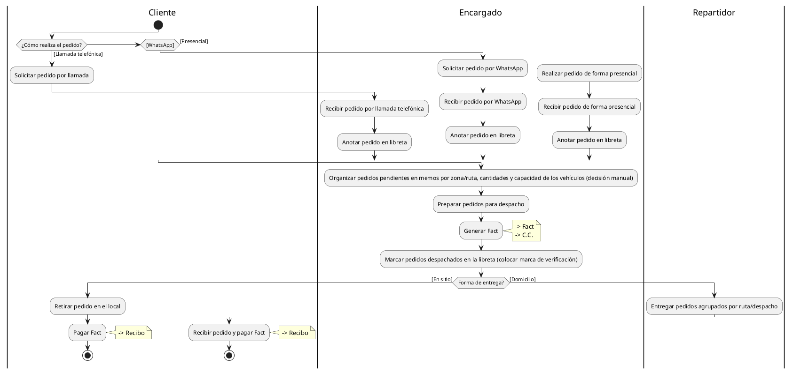

# Proceso de negocio — Ventas (AS-IS)

**Proyecto:** Sistema de Gestión para Tienda de Agua Embotellada "Agua Frais"
**Curso:** Ingeniería de Software — Universidad de Cartagena
**Iteración:** 3 — Modelo de negocio
**Artefacto:** Proceso de negocio (diagrama de carriles/swimlane)
**Responsable:** Analista del sistema

## 1. Diagrama (PlantUML)

## 2. Notas sobre el diagrama

- **Rol:** Se mantiene `Encargado` (en lugar de Vendedor), acorde al contexto del negocio (acta de entrevista 26/08/2026, Anexo C).
- **Recepción:** Se representa con `if/elseif` (alternativas excluyentes), no con `fork`. Esto refleja los canales reales: llamada, WhatsApp o presencial.
- **Organización de despachos:** Se deja explícita la organización manual mediante **memos**, por zona/ruta, cantidades y capacidad de los vehículos (decisión manual).
- **Control de estado:** Se incluye `Marcar pedidos despachados en la libreta (colocar marca de verificación)`, tal como se concluyó en la reunión, para distinguir pedidos pendientes y despachados.
- **Core del proceso de ventas:** Se conserva la estructura base del profesor: **Generar Fact**, **Pagar Fact** y la generación del **Recibo**. Se mantienen las anotaciones `-> Fact`, `-> C.C.` y `-> Recibo`, respetando el modelo base.
- **Agrupamiento por lote:** En el despacho a domicilio se representa `Entregar pedidos agrupados por ruta/despacho`, coherente con la organización manual por zona.
- **Cierre del flujo:** Ambos caminos convergen a `stop`, con un único punto de fin.

## 3. Observación sobre C.C.

La anotación `-> C.C.` corresponde a lo indicado en el modelo base entregado. En el contexto colombiano suele interpretarse como **Comprobante de Contabilidad**. Se conserva tal cual lo solicitó el profesor (mantener el core del modelo base).